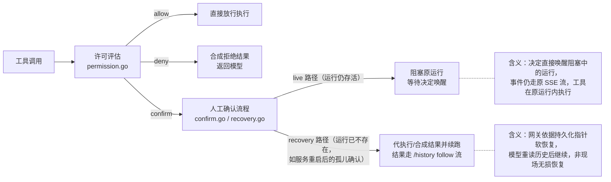
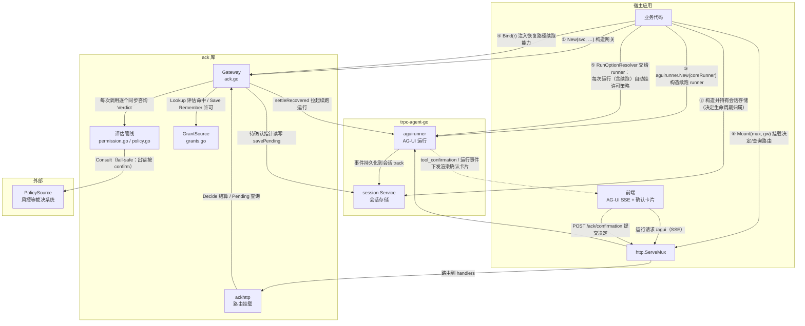
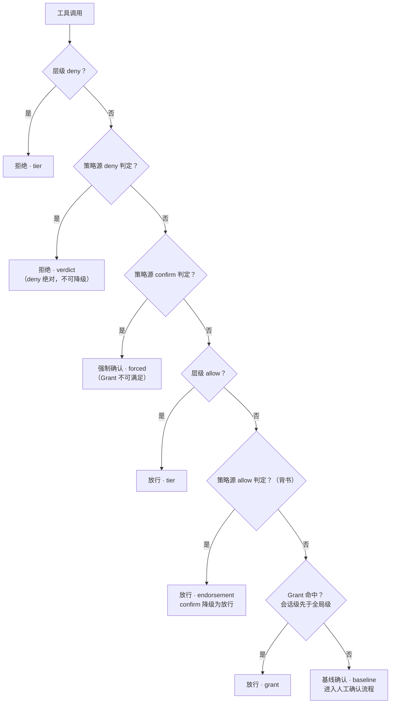
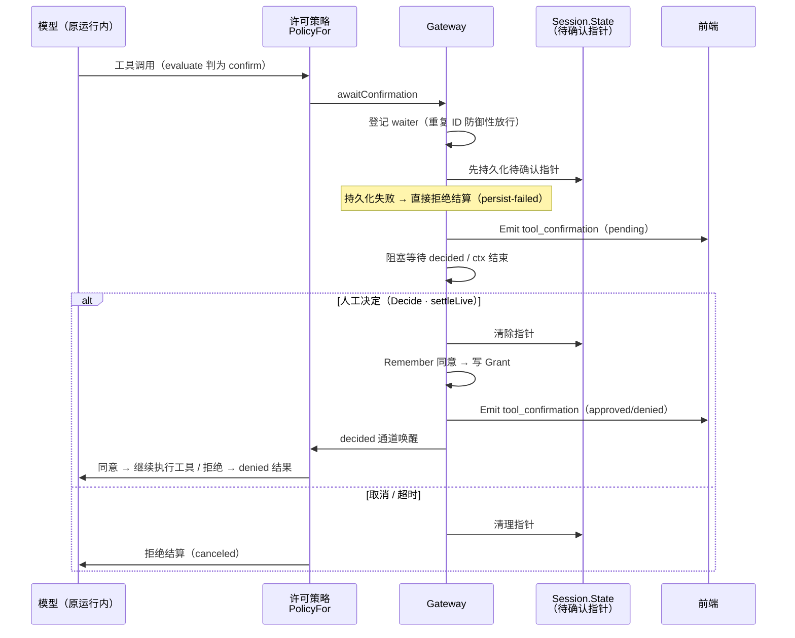
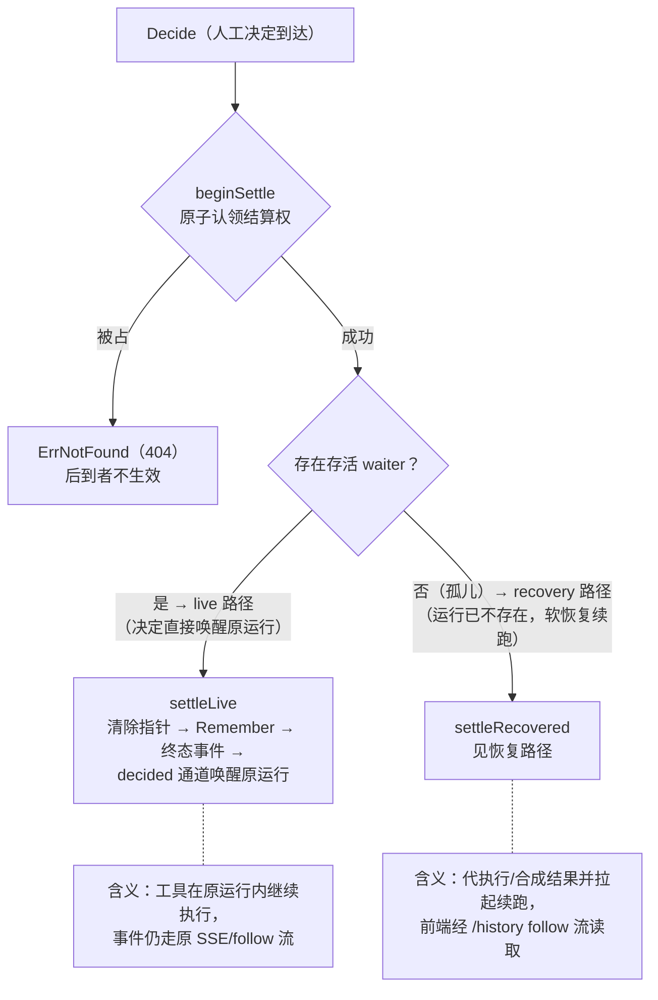
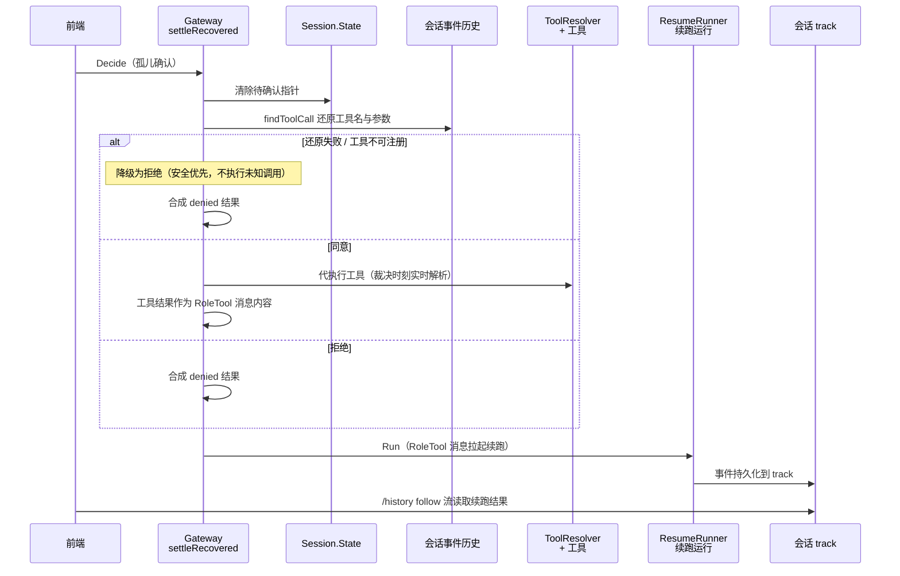
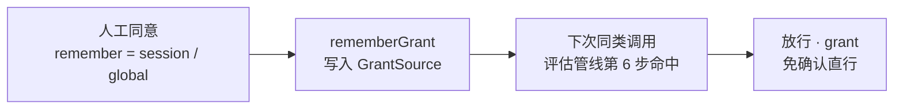

# ack 原理机制

本文从实现视角说明 ack 库各组件的机制与原理；接入步骤与配置项见 [usage.md](./usage.md)，完整设计契约（事件、存储、不变量）见 [module_design.md](./module_design.md)。

## 一、总体架构

`ack` 构建在 trpc-agent-go 的 AG-UI 协议栈之上，核心是一个 `Gateway`（[ack.go](../ack.go)），它拦截每次工具调用，做出三类处置：



- **live 路径**：发出确认的运行仍存活。决定经 `decided` 通道直接唤醒阻塞中的运行，工具在原运行内继续执行，事件仍走原始 SSE/follow 流（§三.1、§三.2 settleLive）。
- **recovery 路径**：运行已不存在（如服务重启后决定才到达的孤儿确认）。网关以待确认持久化指针为准，代执行工具或合成拒绝结果，拉起续跑运行，前端经 `/history` follow 流读取结果（§三.3）。

组件关系：



连线语义速查（编号对应图中①~⑥）：

| 线 | 语义 | 代码位置 |
| --- | --- | --- |
| ① | 业务构造网关，传入会话存储与全部配置 | [ack.go](../ack.go#L164) `New` |
| ② | 会话存储由业务选择后端并持有生命周期，网关只使用 | [ack.go](../ack.go#L42-L45) |
| ③ | 业务构造 AG-UI runner（包装 core runner），其返回值满足 `ResumeRunner` | [ack.go](../ack.go#L22-L24) |
| ④ | 网关注入续跑 runner，恢复路径触发时使用，未 Bind 返回 `ErrNotBound` | [ack.go](../ack.go#L208) `Bind` |
| ⑤ | 网关的 `RunOptionResolver` 使每次运行挂上 `PolicyFor` 许可策略 | [policy.go](../policy.go#L48-L55) |
| ⑥ | ackhttp 把决定/查询路由挂到宿主 mux | [ackhttp/http.go](../ackhttp/http.go#L22) `Mount` |

组件分工：

| 组件 | 文件 | 职责 |
| --- | --- | --- |
| Gateway | [ack.go](../ack.go) | 核心对象：登记等待者、结算决定、恢复孤儿确认；并发安全 |
| 评估管线 | [permission.go](../permission.go) / [policy.go](../policy.go) | 层级解析、策略咨询、处置决策、观察者回调 |
| 许可（Grant） | [grants.go](../grants.go) | 用户预授权存储抽象，满足确认要求 |
| 确认结算 | [confirm.go](../confirm.go) | Decide 结算（live/recovery 分流）、Pending 查询、Remember 写许可 |
| 恢复路径 | [recovery.go](../recovery.go) | 孤儿确认：从会话历史还原调用、代执行工具、拉起续跑 |
| 载荷契约 | [payload.go](../payload.go) | `tool_confirmation` 自定义事件、Session.State 待确认指针 |
| HTTP 绑定 | [ackhttp/http.go](../ackhttp/http.go) | `POST /ack/confirmation`、`GET /ack/confirmations` |
| 测试夹具 | [acktest/](../acktest/) | 脚本化模型、假续跑 runner |

## 二、许可评估管线

评估入口是 `Gateway.evaluate`（[permission.go](../permission.go#L184-L218)），它是（层级、判定集、许可表）的**纯函数**，按固定次序短路：



判定次序逐条说明：

1. **层级 deny** → 拒绝（依据 `tier`）
2. **任一策略源 deny 判定** → 拒绝（依据 `verdict`，来源为首个 deny 的具名源）——deny 绝对，不可降级
3. **任一策略源 confirm 判定** → 强制确认（内部依据 `forced`），许可查询不会发生——强制确认不可被 Grant 满足
4. **层级 allow** → 放行（依据 `tier`）
5. **任一策略源 allow 判定**（背书）→ confirm 层级降级为放行（依据 `endorsement`）
6. **Grant 命中**（会话级先于全局级）→ 放行（依据 `grant`）
7. 兜底 → **基线确认**（内部依据 `baseline`），进入人工确认流程

要点：

- **策略咨询链**（[permission.go](../permission.go#L161-L176)）：具名源在前、匿名源在后，逐个同步咨询。位于工具调用的同步关键路径。咨询出错按 confirm 判定处理（**fail-safe**：裁决权威不可达时不静默放行）。
- **层级解析优先级**：`TierFunc`（动态，可按入参分类）> `WithTiers` 静态表 > 默认层级。
- **授权终态观察**（`PermissionObserver`）：全部自动放行/拒绝终态（tier / verdict / endorsement / grant / duplicate / canceled / persist-failed）在结算同步路径回调宿主审计；**人工决定不发事件**——每次工具调用恰好一条授权终态，要么观察事件、要么 Decide 结算，互斥且共同覆盖。回调 ctx 经 `context.WithoutCancel` 保证未取消，可安全执行 IO。
- **拒绝文案**均含"不得重试"指令，防止模型反复重试被拒工具。

## 三、人工确认生命周期

### 1. 登记与阻塞（live 路径）



`awaitConfirmation`（[policy.go](../policy.go#L59-L117)）：

1. 构造 `Payload` 与带缓冲 `waiter`（`decided chan bool`）；从 ctx 提取存活运行（`eventEmitter`）。
2. 以 `waiterKey(sessionID, confirmationID)` 登记；**同会话重复确认 ID 防御性放行**（依据 `duplicate`）。
3. **先持久化后阻塞**：待确认指针写入 `Session.State`（键 `__pending_tool_confirmation__`）成功后才等待；持久化失败直接按拒绝结算（依据 `persist-failed`）——保证重启后孤儿状态可恢复。
4. 向前端推送 `tool_confirmation` 自定义事件（实时 SSE + track 持久化）。
5. 阻塞等待：`decided` 通道唤醒（人工决定）或运行 ctx 结束（取消/超时 → 清理指针，按拒绝结算，依据 `canceled`）。

### 2. Decide 结算



`Decide`（[confirm.go](../confirm.go#L37-L54)）先原子**认领结算权**（`beginSettle`）：`settling` 表防并发双重结算，后到者返回 `ErrNotFound`（HTTP 404）。按是否存在存活等待者分流：

- **settleLive**（[confirm.go](../confirm.go#L59-L85)）：清除持久化指针 → 写 Remember 许可 → 推送终态确认事件 → 向 `decided` 写入决定唤醒阻塞的运行。同意则工具在原运行内继续执行，事件仍走原 SSE/follow 流；拒绝则框架向模型返回 denied 结果。
- **settleRecovered**：见下节。

### 3. 恢复路径（recovery）

决定到达时运行已不存在（如服务重启），以待确认**持久化指针**为准判定孤儿（[recovery.go](../recovery.go#L26-L98)）：



要点：

1. 清除指针；从**会话事件历史**还原原始工具调用的工具名与参数（`findToolCall`）。
2. **同意**：通过 `ToolResolver` 在服务端**代执行工具**（MCP 等动态工具集在裁决时刻实时解析）；**拒绝**：合成 denied 结果。历史找不回调用或工具不可注册时降级为拒绝续跑（**安全优先**，不执行未知调用）。
3. 以 `RoleTool` 消息拉起一次续跑运行（`ResumeRunner.Run`）；事件由 AG-UI runner 持久化到 track，前端经 `/history` follow 流读取。会话上仍有运行时返回 `ErrRunActive`（HTTP 409）。

这是基于会话历史的**软恢复**（模型重读历史后继续），非执行现场无损恢复。

### 4. Remember 生成许可

人工同意且显式携带 `Remember`（`session`/`global`）时，`rememberGrant` 向 `GrantSource` 写入对应作用域的许可（[confirm.go](../confirm.go#L131-L156)）。写入失败不回退本次放行，仅记日志；未配置许可源时忽略。



下次同类调用在评估管线第 6 步命中，免确认。

## 四、并发不变量

- **结算权互斥**：`beginSettle`/`endSettle`（[confirm.go](../confirm.go#L164-L184)）保证同一确认不会被并发双重结算；并发决定先到者生效。
- **身份校验摘除**：操作性结算（取消/超时/持久化失败）仅当登记者正是本调用的等待者才摘除，防止误摘同 ID 后到的新等待者；被人工决定抢先结算时按该决定返回。
- **单写者持久化**：`savePending` 在网关锁内做"读取→修改→写回"，单进程串行一致。
- **契约只增不改**：事件名 `tool_confirmation`、State 键、Payload 字段是 wire 与存储的兼容性契约，升级只增不改，否则遗留指针失联。

## 五、接入方式

```go
gw := ack.New(svc, ...)                    // 会话存储由业务持有
r := aguirunner.New(coreRunner,
    aguirunner.WithRunOptionResolver(gw.RunOptionResolver()), // 每次运行（含续跑）挂许可策略
)
_ = gw.Bind(r)                             // 恢复路径续跑 runner
ackhttp.Mount(mux, gw)                     // HTTP 决定/查询路由
```

- **直接用 core runner 的业务**：用 `gw.PolicyFor(sessionID)` 取得 `tool.PermissionPolicyFunc` 挂载。
- **前端约定**：消费 `tool_confirmation` 事件渲染确认卡片 → 调 `POST /ack/confirmation`（可带 `remember`）→ 重连时用 `GET /ack/confirmations` 补偿孤儿状态（`live=false`）→ recovery 结果经 `/agui/history` follow 流读取。
- **身份**：`WithUserFunc` 从请求 ctx 取鉴权结果（优先），否则用 `WithUser` 静态值；用户 ID 参与会话存储键与许可查询。
